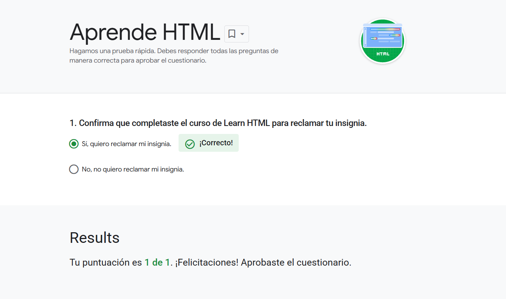

# Portafolio web personal — Learn HTML (web.dev)

Portafolio estático construido con **HTML5 semántico, CSS3 y JavaScript nativo**, sin librerías ni frameworks. Aplica progresivamente los 22 módulos del curso [Learn HTML de web.dev](https://web.dev/learn/html).

🔗 **Demo en vivo:** https://estefaniacruz64892.github.io/portafolio/

---

## 🏅 Certificación

Completé el curso **Learn HTML** de web.dev y su cuestionario final.



---

## 📁 Estructura del proyecto

```
portafolio/
├── index.html            # Documento único: estructura semántica de todo el sitio
├── css/
│   └── styles.css        # Estilos globales (variables, layout, componentes)
├── js/
│   ├── project-card.js   # Web Component <project-card> con Shadow DOM
│   └── main.js           # Validación del formulario + modal <dialog>
├── img/
│   ├── avatar.svg
│   └── favicon.svg
├── docs/
│   └── badge-learn-html.png
└── README.md
```

**Separación de responsabilidades:** el HTML define *qué es* cada contenido, el CSS define *cómo se ve* y el JavaScript solo agrega comportamiento que HTML no puede resolver por sí solo. Si el JavaScript falla, la página sigue siendo legible y navegable (*progressive enhancement*).

---

## 🏗️ Decisiones arquitectónicas y semánticas

### 1. Documento y metadatos (Módulos 2-4)
- `lang="es"` en `<html>`: los lectores de pantalla pronuncian en español y los buscadores identifican el idioma.
- `<meta charset="UTF-8">` va **primero** en el `<head>`, para que tildes y eñes se interpreten bien desde el primer byte.
- `viewport` con `width=device-width`: sin esto, el móvil renderiza la página como si fuera de escritorio y la reduce.
- `description` y Open Graph: controlan el texto que aparece en Google y la vista previa al compartir el link.
- Scripts con `defer`: no bloquean la construcción del DOM y se ejecutan en orden cuando el documento está listo.

### 2. Estructura semántica (Módulos 5-6)
| Elemento | Uso en el sitio | Por qué este y no un `<div>` |
|---|---|---|
| `<header>` | Logo y navegación | Se expone como *landmark* "banner" en el árbol de accesibilidad |
| `<nav aria-label>` | Menú principal y redes sociales | Hay dos `<nav>`, el `aria-label` los distingue para el lector de pantalla |
| `<main>` | Todo el contenido principal (uno solo) | Destino del *skip link* y *landmark* "main" |
| `<section aria-labelledby>` | Cada bloque temático | Cada una tiene su propio `<h2>`, que le da su nombre accesible |
| `<article>` | Cada tarjeta de proyecto | Es contenido independiente: tiene sentido fuera de la página |
| `<figure>` + `<figcaption>` | Avatar | Asocia la imagen con su leyenda |
| `<footer>` | Copyright y redes | *Landmark* "contentinfo" |

**Jerarquía de encabezados:** un único `<h1>` (presentación), un `<h2>` por sección y `<h3>` en cada proyecto. No se salta ningún nivel. El algoritmo de *outline* de HTML5 nunca se implementó en los navegadores, así que la jerarquía real la definen los niveles `h1`-`h6`, no el anidamiento de `<section>`.

**`<div>` solo donde no hay significado:** se usan para contenedores de layout (`.container`, `.projects-grid`) porque esos elementos son puramente visuales.

### 3. Texto, enlaces y navegación (Módulos 7-11, 19)
- Navegación con anclas internas (`href="#proyectos"` → `id="proyectos"`) dentro de una lista `<ul>`, para que el lector de pantalla anuncie cuántos enlaces hay.
- `scroll-padding-top` en CSS evita que el header fijo tape el título de la sección al saltar.
- Enlaces externos con `rel="noopener"`: la página abierta no puede manipular la pestaña original mediante `window.opener`.
- Elementos de texto en línea con significado: `<abbr title>` para siglas (SQL, GAS, HTML), `<time datetime>` para fechas legibles por máquina, `<strong>` para importancia y `<code>` para fragmentos de código.

### 4. Tabla de habilidades (Módulo 12)
- `<caption>` describe la tabla. `<th scope="col">` y `<th scope="row">` asocian cada celda con su encabezado de columna y de fila, así el lector de pantalla lee "SQL, Nivel: Intermedio".
- Envuelta en un contenedor con `overflow-x: auto`, `role="region"` y `tabindex="0"`, para que en móvil se pueda desplazar también con teclado.
- Se usa tabla porque los datos **son tabulares**. Nunca para maquetar.

### 5. Formulario de contacto (Módulo 13)
- **Validación nativa delegada al navegador:** `required`, `type="email"`, `pattern` (teléfono), `minlength` y `maxlength`. Si algo falla, el evento `submit` ni siquiera se dispara.
- `:user-invalid` en CSS marca el error **solo después** de que el usuario interactuó con el campo, no apenas carga la página.
- Cada campo tiene `<label for>`. Las ayudas se conectan con `aria-describedby`. Los grupos se agrupan con `<fieldset>` + `<legend>`.
- `autocomplete` (`name`, `email`, `tel`): el navegador autocompleta y el usuario escribe menos.
- **GET vs POST:** se usa `method="post"` porque los datos personales no deben viajar en la URL. Con GET quedarían en el historial, en los logs del servidor y en el encabezado *Referer*.
- ⚠️ **La validación del navegador es solo la primera capa.** Se puede saltar desde DevTools o enviando la petición directamente, así que el backend siempre debe volver a validar.

### 6. Imágenes (Módulo 14)
- Todas las imágenes tienen `alt` descriptivo.
- `width` y `height` explícitos: el navegador reserva el espacio antes de descargar la imagen y no hay saltos de diseño (*Cumulative Layout Shift*).
- `loading="lazy"` y `decoding="async"` difieren la carga de imágenes que no están en pantalla.
- Formato SVG: vectorial, pesa menos de 1 KB y se ve nítido en cualquier resolución.

### 7. Web Component `<project-card>` (Módulo 16)
- `<template>`: el navegador analiza su contenido pero **no lo renderiza** hasta que se clona.
- **Shadow DOM** (`attachShadow`): los estilos de la tarjeta quedan encapsulados. Ni se filtran hacia afuera ni el CSS global los rompe.
- **Slots con nombre** (`title`, `description`, `tags`): el contenido se escribe en el HTML principal (bueno para SEO y legible sin JS) y el componente solo define dónde se muestra.
- **Puente controlado con el tema:** las *custom properties* (`--card-bg`, `--accent`) sí atraviesan el Shadow DOM, por eso las tarjetas cambian con el modo oscuro sin romper la encapsulación.
- **Por qué importa a escala:** es el mismo principio de los micro-frontends. Varios equipos pueden publicar componentes en la misma página sin que choquen sus estilos.

### 8. Foco y accesibilidad con teclado (Módulo 18)
- *Skip link* "Saltar al contenido principal": oculto hasta que se pulsa `Tab`.
- `:focus-visible`: el contorno de foco aparece al navegar con teclado, no al hacer clic con el mouse.
- `prefers-reduced-motion`: se desactivan animaciones y scroll suave si el usuario lo pidió en su sistema.
- `prefers-color-scheme`: modo oscuro automático.

### 9. Preguntas frecuentes con `<details>` (Módulo 20)
- Acordeón sin una línea de JavaScript.
- El atributo `name="faq"` en todos los `<details>` lo vuelve **exclusivo**: abrir uno cierra los demás.
- El contenido está en el HTML, así que los buscadores lo indexan aunque esté colapsado.

### 10. Modal con `<dialog>` (Módulos 17 y 21)
- `showModal()` (API nativa) da gratis lo que antes requería una librería: fondo inerte, foco atrapado dentro del modal, cierre con `Esc` y capa `::backdrop`.
- `<form method="dialog">` cierra el modal con un botón, sin JavaScript.
- Los datos del usuario se insertan con `textContent` y **nunca con `innerHTML`**, para evitar inyección de código (XSS).

---

## 🗺️ Mapa de módulos → implementación

| Módulos del curso | Dónde se aplica |
|---|---|
| Overview, Document structure, Metadata | `<head>` de `index.html` |
| Semantic HTML, Headings and sections | `header`, `nav`, `main`, `section`, `article`, `footer` |
| Attributes, Text basics, Other inline text elements | `id`, `aria-*`, `<abbr>`, `<time>`, `<strong>`, `<code>` |
| Links, Lists, Navigation | Menú con anclas, redes sociales |
| Tables | Sección Habilidades |
| Forms | Sección Contacto |
| Images | Avatar en Sobre mí |
| Audio and Video | Ver "Siguientes pasos" |
| Template, slot, and shadow | `<template>` + `js/project-card.js` |
| HTML APIs, Dialog | `js/main.js` + `<dialog>` |
| Focus | *Skip link*, `:focus-visible`, `tabindex` |
| Details and summary | Sección Preguntas frecuentes |

---

## ▶️ Cómo ejecutarlo

No requiere instalación. Abre `index.html` en el navegador.

Para probarlo como en producción (recomendado):

```bash
# Con Python
python -m http.server 8000
# Luego abre http://localhost:8000
```

**Activar el envío real del formulario:**
1. Crea un formulario gratuito en [Formspree](https://formspree.io) y copia tu ID.
2. En `index.html`, reemplaza `TU_ID` en el `action` del formulario.
3. En `js/main.js`, cambia `DEMO_MODE` a `false`.

---

## ✅ Validación

- [ ] HTML validado sin errores en el [W3C Markup Validator](https://validator.w3.org/)
- [ ] Auditoría de Lighthouse (DevTools → Lighthouse) con Accesibilidad ≥ 95
- [ ] Navegación completa usando solo el teclado (`Tab`, `Shift+Tab`, `Enter`, `Esc`)

---

## 🚀 Siguientes pasos

- Agregar un video corto de un proyecto con `<video controls>`, `<track kind="captions">` para subtítulos y `poster` para la miniatura.
- Convertir las imágenes de proyectos a WebP/AVIF con `<picture>` y `srcset`.

---

**Autora:** Estefanía · Estudiante de Ingeniería Informática
